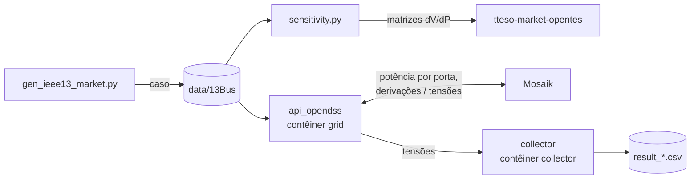

# tsre-der-opentes: a rede elétrica do OpenTES

Branch `integration-tsre`, a versão deste repositório que entra na co-simulação
[co-simulation-opentes](https://github.com/grei-ufc/co-simulation-opentes) como
submódulo em `teams/tsre-der-opentes`. Ela guarda só o que o caso do mercado
transativo sobre a IEEE 13 barras usa. Os demais circuitos, cenários e modelos
(34 e 123 barras, LV, baterias, inversores, veículos elétricos, visualização web,
testes e documentação) continuam na branch `main`.

## O papel no projeto



- **Antes da co-simulação:** `gen_ieee13_market.py` monta o caso a partir do
  circuito oficial, e `sensitivity.py` mede, por perturbação no próprio OpenDSS,
  quanto a tensão de cada barra ou fase muda com 1 kW injetado em cada ponto.
- **Durante a co-simulação:** o adaptador expõe o circuito ao Mosaik. A cada
  15 minutos recebe a potência de cada carga e porta de armazenamento e as
  derivações do regulador, resolve o fluxo e devolve as tensões.
- **Na saída:** o coletor grava um CSV por passada. A fase que a barra não tem
  fica `NaN`, porque `0.0` é medição válida (tensão crítica) para a ARGOS do TSDQ.

## O que há aqui

```
src/simulators/
  opendss/               adaptador Mosaik do OpenDSS (api_opendss) e fachada do motor
  collector/             coletor dos resultados em CSV
  gen_ieee13_market.py   monta o caso de mercado
  sensitivity.py         matrizes de sensibilidade de tensão, por barra e por fase
  pv_creator.py          curvas de irradiância e temperatura dos cinco PV
  pv_validator.py        conferências das curvas e da ligação dos PV
data/
  13Bus/                 o caso: circuito, perfis, alocação, posições de rádio, matrizes
  InfoPV/                estações solares (BR-PVGen) que alimentam o pv_creator
dockerfile, requirements.txt   a imagem opentes/grid
pyproject.toml, uv.lock        o mesmo pacote, para uso local com uv
```

Os arquivos de `data/13Bus/` que **não** são gerados: o circuito oficial
(`IEEE13Nodeckt*.dss`, `IEEELineCodes.dss`, `LoadShape.dss`), as curvas de PV
(`ieee13_*_5min.*`, saídas do `pv_creator`) e o preço spot (`spot_price.csv`).
O resto sai do `gen_ieee13_market.py` e do `sensitivity.py`. As matrizes
`sensitivity_*.npz` e as topologias `tisch_links_wisun_*.csv` ficam fora do git,
e o `run.sh` da co-simulação as regenera quando faltam.

## Decisões do caso

| Item | O que vale nesta branch |
|---|---|
| Fase ausente | `NaN` no adaptador e no coletor |
| Regulador no circuito | `static`, `MaxTapChange=16` e um `Solve` ao compilar |
| Derivação do regulador | `static` sobre a previsão, enviada ao regulador a cada passo |
| Controlador externo `VR_Model` | não usado |
| Ajustes do `RegControl` | oficiais da IEEE 13 |
| Carga | uma carga equilibrada por barra, modelo 1 |
| Curvas de carga | as oficiais de 10 min |
| Geração fotovoltaica | cinco PV (15 MW) como carga negativa |

## Rodar

Dentro da co-simulação, pelo `run.sh` da raiz: `./run.sh market` sobe os
contêineres `grid` e `collector`, e `./run.sh caso` regenera o caso e as
matrizes. Para rodar uma ferramenta isolada:

```bash
docker compose build grid
# o caso, a partir do circuito oficial e das curvas de PV
docker compose run --rm --no-deps grid python src/simulators/gen_ieee13_market.py
# a matriz por fase (sem --por-fase, a por barra)
docker compose run --rm --no-deps -e GRID_DIR=/app/data/13Bus grid \
  python src/simulators/sensitivity.py day --por-fase \
  --load-csv /app/data/13Bus/load_kw.csv --pv-csv /app/data/13Bus/pv_kw.csv \
  --out /app/data/13Bus/sensitivity_fase.npz
# as curvas de PV, se as estações mudarem
docker compose run --rm --no-deps grid python src/simulators/pv_creator.py
```

Os simuladores `--remote` aceitam **uma única** conexão Mosaik e encerram depois
dela: não sonde as portas com TCP. O OpenDSS da imagem só carrega rodando como
root no contêiner.

## Autoria

O adaptador do OpenDSS, o coletor e o gerador de curvas de PV são da equipe TSRE
do OpenTES. O caso de mercado e as matrizes de sensibilidade vieram do
`co-simulation-opentes` (equipe TTESO).
