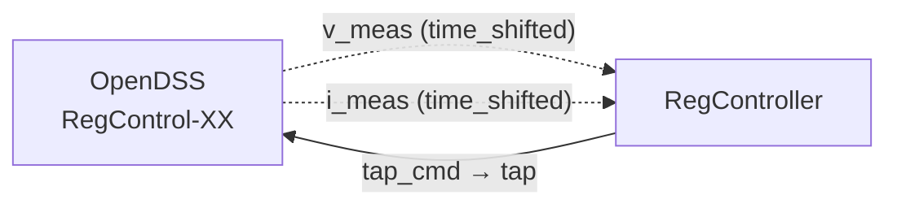

# Configurar Regulador de Tensão

## Visão geral

O regulador de tensão (tap changer) ajusta a posição de tap de um transformador para manter a tensão dentro de uma faixa aceitável. Este guia explica como configurar e usar o `VR_Model`.

## Quando usar

- Cenários com reguladores de tensão no circuito OpenDSS
- Controle de tap com compensação de queda de linha (LDC)
- Validação de estratégias de regulação

## Parâmetros do regulador

| Parâmetro | Tipo | Default | Descrição |
|---|---|---|---|
| `Vref` | `float` | 120 | Tensão de referência no secundário (V) |
| `db` | `float` | 2 | Largura da faixa morta (V) |
| `PT_Ratio` | `float` | 20 | Razão do transformador de potencial |
| `CT_Primary` | `float` | 700 | Corrente nominal do CT (A) |
| `LDC_R` | `float` | 0 | Resistência da compensação LDC (Ω) |
| `LDC_X` | `float` | 0 | Reatância da compensação LDC (Ω) |
| `Td_ctrl` | `float` | 30 | Atraso de controle (s) |
| `Td_tap` | `float` | 2 | Atraso entre taps (s) |
| `tap_max` | `int` | 16 | Tap máximo |
| `tap_min` | `int` | -16 | Tap mínimo |
| `tap_ini` | `int` | 0 | Posição inicial do tap — use a do circuito, `extra_info["tap_ini"]` |

## O controle nativo do OpenDSS fica travado

O adaptador OpenDSS trava o controle automático de todos os `RegControl` ao
carregar o circuito (`MaxTapChange=0`), antes da primeira solução. Os taps ficam
na posição que o `.dss` declara durante todo o estudo e **só mudam por um
controlador externo**, como o `RegController`; o tap comandado permanece até o
próximo comando.

Duas consequências:

- **Sem controlador, o tap não muda.** Um cenário que não conecta um
  `RegController` roda com os reguladores fixos na posição declarada.
- **Inicie o controlador no tap real.** O `RegController` guarda a própria
  posição e a envia como `tap_cmd` a cada passo, sem ler a do circuito.
  Criado com `tap_ini=0` num alimentador que declara outro tap, ele o troca
  por 0 já no primeiro passo. O adaptador reporta o tap declarado em
  `extra_info["tap_ini"]`:

```python
for info in dss_sim.get_detected_regulators():
    ctrl = reg_sim.RegController(
        vreg=info["vreg"], band=info["band"], pt_ratio=info["pt_ratio"],
        ct_primary=info.get("ct_primary", 0), R=info.get("R", 0), X=info.get("X", 0),
        delay=info["delay"], tap_delay=info["tap_delay"],
        tap_ini=info["tap_ini"],
    )
```

## Cenários de referência

Usam o regulador: `opendss_scenario_34bus.py`, e os cenários com visualização
`opendss_scenario_34bus_web.py`, `opendss_scenario_123bus_web.py` e
`opendss_scenario_123bus_pv_web.py`.

```bash
uv run --no-sync python scenarios/opendss_scenario_34bus.py
```

Esses cenários:

1. Descobrem automaticamente os reguladores do circuito
2. Criam uma entidade `RegController` para cada regulador, no tap declarado
3. Conectam as medições de tensão e corrente do OpenDSS ao controlador
4. Enviam os comandos de tap (`tap_cmd` → `tap`) de volta ao OpenDSS

## Conexões de feedback



O `time_shifted=True` é essencial para evitar ciclos causais.

## Lógica de controle

1. Mede tensão no bus alvo
2. Aplica compensação LDC: `Vreg = |Vsec - Vdrop|`
3. Compara com `Vref ± db/2`:
   - Acima → Overvoltage → diminui tap
   - Abaixo → Undervoltage → aumenta tap
   - Dentro → Idle
4. Espera `Td_ctrl` segundos antes de agir
5. Espera `Td_tap` segundos entre mudanças de tap
